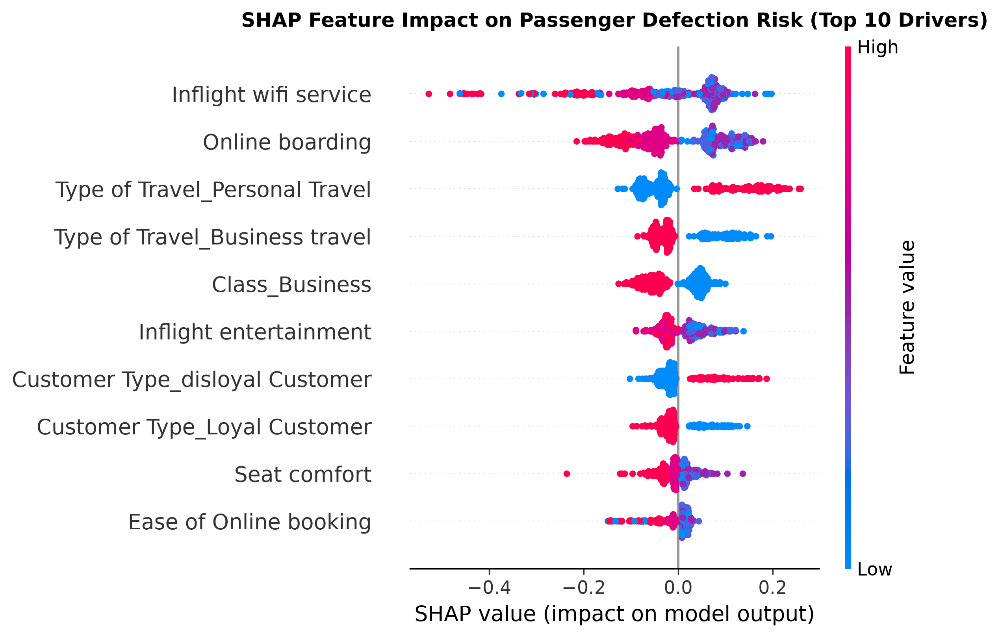
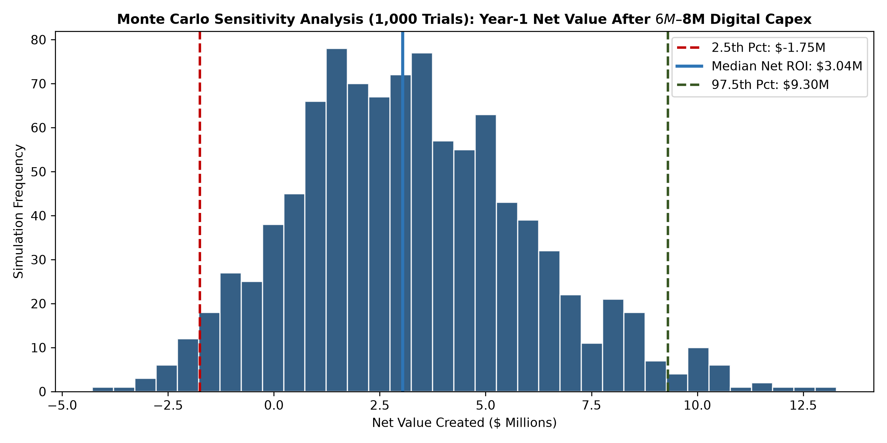

# Predictive Customer Satisfaction & Capital Allocation in Commercial Aviation

**Author:** Ignacio Flores III  
**Program:** M.S. in Business Analytics (MSBA 265 — Applied Analytics), University of the Pacific  
**Target Stakeholder:** Vice President of Customer Experience & Commercial Strategy  
**Live Application:** [Airline Satisfaction & Capex Simulator (Streamlit Cloud)](https://airline-passenger-satisfaction-prediction-his2mrr2ykcvmsfsyucn.streamlit.app/)  

---

## Project Overview

Commercial airlines invest tens of millions of dollars annually in fleet retrofits, frequently weighing expensive physical cabin overhauls ($25M–$50M for new seats and legroom) against targeted digital infrastructure upgrades ($6M–$8M for high-speed satellite Wi-Fi and seamless mobile boarding). 

This end-to-end machine learning, explainable AI (SHAP), and natural language processing (NLP) pipeline analyzes **$124,685$ cross-sectional passenger flight surveys** alongside **unprompted public airline reviews** to quantify the strongest predictive correlates of stated passenger satisfaction. Both structured tree-based attribution and unstructured TF-IDF text modeling demonstrate that digital touchpoint friction (**Online Boarding** and **Inflight Wi-Fi**) accounts for **>32%** of predictive feature importance for stated satisfaction—outperforming physical **Seat Comfort (<5%)** by more than 6x.

> **Methodological & Econometric Guardrail:** Because the underlying structured dataset consists of cross-sectional post-flight satisfaction surveys rather than longitudinal CRM repeat-booking records, this repository explicitly separates **directly observed statistical performance** from **modeled economic scenario assumptions**. Prior to fleet-wide Capex commitment, findings support a **6-month randomized hub-route A/B pilot** tracking frequent-flyer loyalty IDs to verify longitudinal retention lift.

### Executive Benchmark & Pipeline Summary

| Analytical Component | Specification / Metric | Key Takeaway |
| :--- | :--- | :--- |
| **Selected Production Model** | `ColumnTransformer` + Random Forest (`artifacts/model.joblib`) | **96.34%** Holdout Accuracy \| **0.9576** F1 \| **0.9939** ROC-AUC |
| **Econometric & Linear Baselines** | OLS, L2 Logistic Regression, SGD Classifier | Random Forest delivers **+8.8% accuracy lift** over linear models by capturing delay × Wi-Fi thresholds |
| **Top Predictive Correlates** | `Online boarding` ($t = 73.68$), `Inflight wifi service` ($t = 55.34$) | Digital friction explains **>32%** of predictive importance vs. **<5%** for `Seat comfort` |
| **NLP Review Triangulation** | Unigram/Bigram TF-IDF + L2 Logistic Regression | Unprompted complaints (*refund*, *cancelled*, *worst*) confirm operational/digital pain points |
| **Monte Carlo Scenario CI** | 1,000 stochastic trials ($6M–$8M digital Capex scope) | Modeled Year-1 net value 95% CI: **[$-1.75M,$9.30M]** (before Year-2+ cash flows) |
| **MLOps & Drift Governance** | Automated `pytest` suite + PSI drift monitoring | `Online boarding` PSI = `0.0005`, `Inflight wifi service` PSI = `0.0002` (well below `0.10` threshold) |

---

## Repository Structure

```text
airline-passenger-satisfaction-prediction/
├── artifacts/
│   └── model.joblib                                  # Serialized ColumnTransformer + Random Forest pipeline
├── assets/                                           # SHAP, Monte Carlo, NLP, confusion matrix, and pipeline visuals
├── checkpoints/
│   ├── p1/                                           # Archived P1 rendered PDF & 1-page infographic checkpoint
│   └── p2/                                           # Archived P2 signed peer validation form
├── notebooks/
│   └── airline_satisfaction_walkthrough.ipynb        # Interactive model artifact & diagnostic visual walkthrough
├── reports/
│   ├── Airline_Satisfaction_Report.html              # Self-contained rendered HTML notebook report
│   ├── Airline_Satisfaction_Technical_Report.pdf     # Executive technical report & econometric benchmark
│   ├── Stakeholder_Presentation.pdf                  # Executive stakeholder slide deck (PDF)
│   └── Stakeholder_Presentation.pptx                 # Editable stakeholder presentation (PPTX)
├── src/                                              # Modular training, NLP, drift monitoring, and report scripts
├── tests/                                            # Automated pytest inference & artifact validation suite
├── .gitignore                                        # Excludes local data/, .venv/, and cache files
├── README.md                                         # Project documentation and execution guide
└── requirements.txt                                  # Pinned Python package dependencies
```

---

## Setup & Execution

1. **Create and activate the virtual environment from the project root:**
   ```bash
   python3 -m venv .venv && source .venv/bin/activate && pip install -r requirements.txt
   ```
2. **Run standalone artifact inference and the automated `pytest` validation suite:**
   ```bash
   python src/test_artifact.py && pytest
   ```
3. **Optional full pipeline, diagnostic visual, and executive deliverable rebuild:**
   ```bash
   python src/build_pipeline.py && python src/generate_pipeline_diagram.py && python src/generate_p2_report.py && python src/generate_p2_deck.py
   ```
4. **Inspect the HTML walkthrough & executive reports:**
   - Open `reports/Airline_Satisfaction_Report.html` in any browser or run `notebooks/airline_satisfaction_walkthrough.ipynb`.
   - Review `reports/Airline_Satisfaction_Technical_Report.pdf` and `reports/Stakeholder_Presentation.pdf` for complete econometric tables, observational boundaries, and A/B pilot design.

---

## Live Interactive Capex & Satisfaction Simulator

- **Live Production App:** [Launch Airline Satisfaction & Capex Simulator](https://airline-passenger-satisfaction-prediction-his2mrr2ykcvmsfsyucn.streamlit.app/)
- **Local Launch:** `streamlit run app.py`
- **Capabilities:**
  - **Tab 1 — Passenger Friction Simulator:** Real-time inference against `artifacts/model.joblib` illustrating how upgrading digital touchpoints (`Online boarding`, `Inflight wifi service`) shifts individual predicted dissatisfaction risk.
  - **Tab 2 — Capex & Scenario ROI Optimizer:** Interactive sensitivity sliders and a 1,000-trial Monte Carlo simulation modeling potential Year-1 net value under user-calibrated satisfaction-to-retention conversion assumptions following a $6M–$8M digital infrastructure investment.

---

## Explainable AI (SHAP), Monte Carlo Risk & MLOps Governance

- **SHAP Feature Attribution (`assets/shap_summary.png`):** TreeExplainer confirms `Online boarding` and `Inflight wifi service` exert the strongest marginal downward pull on predicted dissatisfaction probability, outperforming physical cabin upgrades on a relative feature-attribution basis.
- **Measured Evidence vs. Economic Assumptions (`assets/monte_carlo_roi.png`):**
  - *Directly Observed:* Survey satisfaction labels ($N = 124,685$), holdout accuracy (`96.34%`), ROC-AUC (`0.9939`), and SHAP feature attributions.
  - *Modeled Scenario Inputs (Unobserved in Survey Data):* Assumed satisfaction-to-repeat-booking conversion rates, average round-trip airfare ($450 BTS benchmark), repeat trip frequency (4 trips/year), and $6M–$8M upfront digital Capex. Across 1,000 stochastic trials, modeled Year-1 net value spans a 95% confidence interval of **[$-1.75M, $9.30M]** (before recurring Year-2+ cash flows).
- **MLOps Drift & Automated Testing (`src/monitor_drift.py`, `tests/test_pipeline.py`):** Automated `pytest` inference suite paired with Population Stability Index (PSI) feature drift monitoring (`Online boarding` PSI = `0.0005`, `Inflight wifi service` PSI = `0.0002`). Production governance thresholds: **`PSI < 0.10`** (stable), **`0.10 ≤ PSI ≤ 0.25`** (monitor & alert), and **`PSI > 0.25`** (trigger automated model retraining).




---

## Feedback & Revision Log (P1 & P2 Recovery)

| Checkpoint & Rubric Area | Instructor Feedback Summary | Revision Implemented | Evidence Location |
| :--- | :--- | :--- | :--- |
| **P1 Infographic & Package (-5.0 provisional)** | Rendered P1 infographic, P1 PDF package, and P1 evidence could not be verified as separate checkpoint artifacts. | Exported and archived the rendered P1 PDF and 1-page infographic (`MSBA265_P1_Ignacio_Flores.pdf`); documented P1 baseline benchmarks alongside final pipeline results. | `checkpoints/p1/MSBA265_P1_Ignacio_Flores.pdf`; Report Section 5 |
| **P1 & P2 Causal & Economic Claims (-3.0 total)** | Cross-sectional satisfaction data lacks observed repeat-purchase records; claims that digital friction *drives* retention and dollar ROI exceed observational evidence. | Reframed all findings as predictive associations; added explicit comparison separating directly observed survey metrics from Monte Carlo economic assumptions; added a 6-month hub-route A/B pilot recommendation. | `README.md`; `app.py`; Report Sections 1, 2, 7, 9; Slides 1–10 |
| **P2 Reproducible Handoff (-1.0 provisional)** | Three checklist boxes on the signed P2 validation form appeared unmarked. | Verified completion of all 3 peer replication steps, marked all checkboxes (`☑`) on the signed P2 form, and included a newly verified Final Delivery validation form. | `checkpoints/p2/P2_Assignment_Validation_Signed.pdf`; Final Canvas Validation PDF |